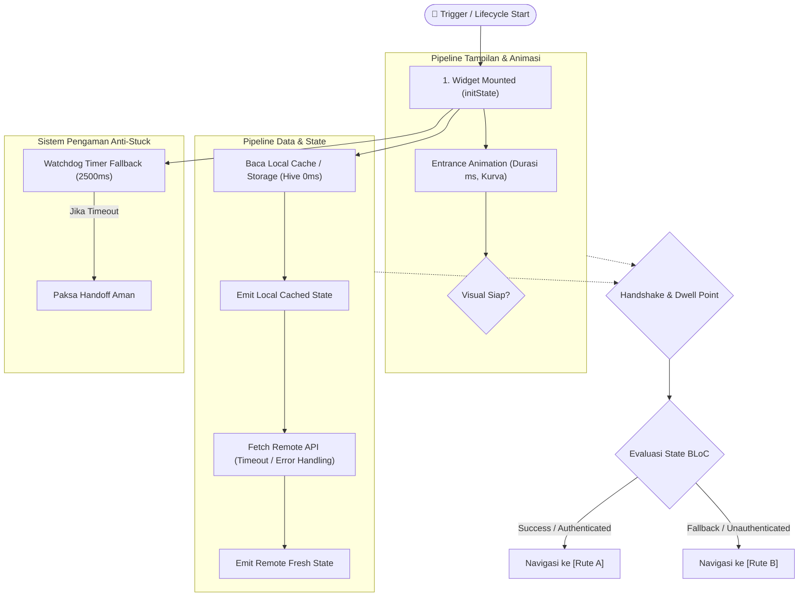

# [Nama Modul / Layar] - Architecture Blueprint & Technical Specification

> Dokumen cetak biru teknis standar enterprise untuk modul `[Nama Modul]` pada repository `[Nama Repository]`.

---

## 1. Alur Kerja Menyeluruh (Lifecycle Flowchart)



---

## 2. Dekonstruksi Komponen (Component Hierarchy)

```
┌────────────────────────────────────────────────────────────────────────┐
│  Root Container (Positioned.fill / StackFit.expand)                   │
│  ├── Layer 1: Background & Ambient Effects (RepaintBoundary)           │
│  │   └── Gradient Orbs / Canvas Background                             │
│  │                                                                     │
│  └── Layer 2: Main Content Layout (SafeArea)                           │
│      └── SizedBox(width: double.infinity)                              │
│          └── Column / CustomScrollView                                 │
│              ├── Header Section (Top Bar / Emblem / Greeting)          │
│              ├── Primary Interactive Module (Form / Bento Grid)        │
│              └── Footer / Status Indicator                             │
└────────────────────────────────────────────────────────────────────────┘
```

### Rincian Spesifikasi Komponen:

| Komponen | Implementasi Widget | Keunggulan & Optimasi |
| :--- | :--- | :--- |
| **Root Shell** | `Positioned.fill` + `StackFit.expand` | Memastikan layout presisi di tengah layar penuh (anti-geser). |
| **GPU Layer** | `RepaintBoundary` | Isolasi repaint GPU mencegah frame drop saat animasi berjalan. |
| **Tipografi** | `GoogleFonts.plusJakartaSans` | Tipografi konsisten 100% selaras dengan desain sistem. |
| **Status Real-time** | `AnimatedSwitcher` + `BlocBuilder` | Reaktif terhadap perubahan data sesi secara instan. |

---

## 3. Kerangka Kerja & Fisika Animasi

| Parameter | Nilai / Implementasi | Keterangan |
| :--- | :--- | :--- |
| **Entrance Animation** | Duration: `... ms`, Curve: `Curves.easeOutCubic` | Skala halus dari `0.90` ke `1.00`. |
| **Transition Route** | `SmoothWelcomePageRoute` (Duration: `650 ms`) | Pergeseran naik ~90px dengan kurva `Cubic(0.05, 0.70, 0.10, 1.00)`. |
| **Exit Animation** | Duration: `350 ms`, Fade: `1.0 -> 0.0` | Efek mekar dan larut lembut (*dissolve*). |
| **Haptic Feedback** | `HapticFeedback.lightImpact()` | Sentuhan mikro getar saat transisi selesai. |

---

## 4. Reliabilitas & Pengamanan (Fail-Safe Mechanisms)

1. **Watchdog Timer Anti-Stuck**:
   * Timer otomatis berjalan di latar belakang untuk mencegah layar menggantung tanpa batas jika koneksi server bermasalah.
2. **Race Condition Prevention**:
   * Membaca `cubit.state` secara sinkron pada `initState` / `addPostFrameCallback` agar state yang di-emit sebelum `BlocListener` mount tidak terlewat.
3. **Smart Back Navigation**:
   * Mengatur tombol kembali Android (`PopScope`) dengan mekanisme yang intuitif (*Double-Tap to Exit* di halaman beranda).

---

## 5. Metrik Kinerja

* **Target Rendering**: 120 FPS Solid tanpa frame drop Choreographer.
* **Heap Allocation**: 0 Bytes alokasi ulang pada CustomPainter.
* **Status Analisis**: `flutter analyze --no-fatal-infos` (0 issues).
* **Status Pengujian**: `flutter test` (100% passed).
